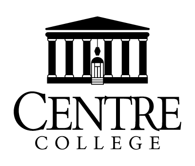
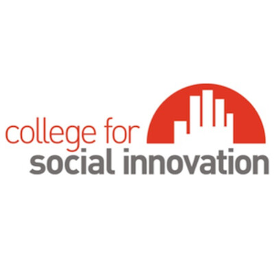
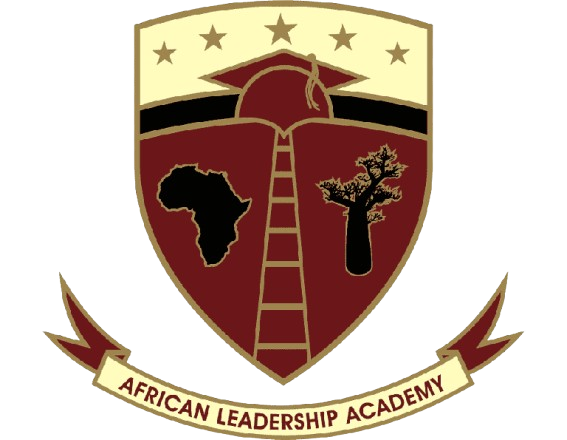
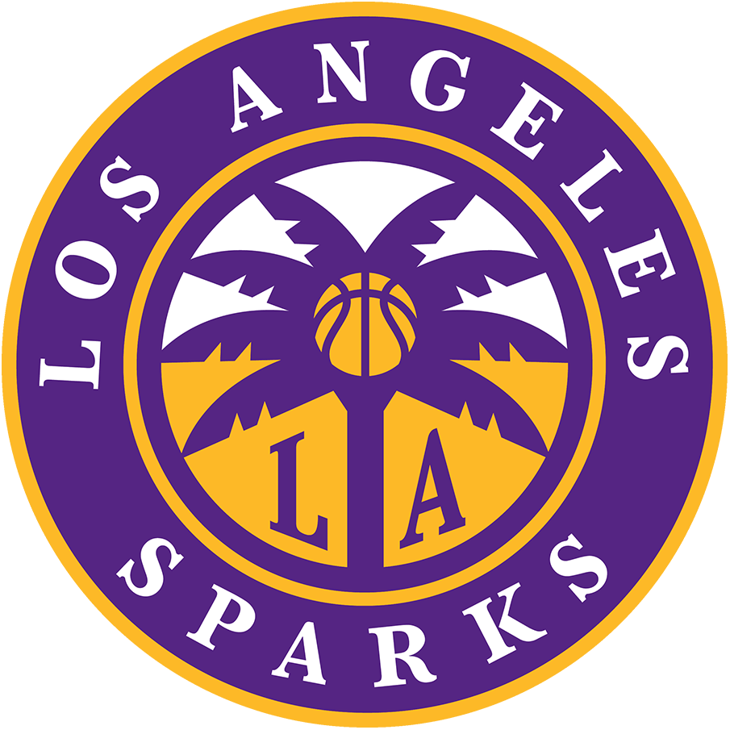
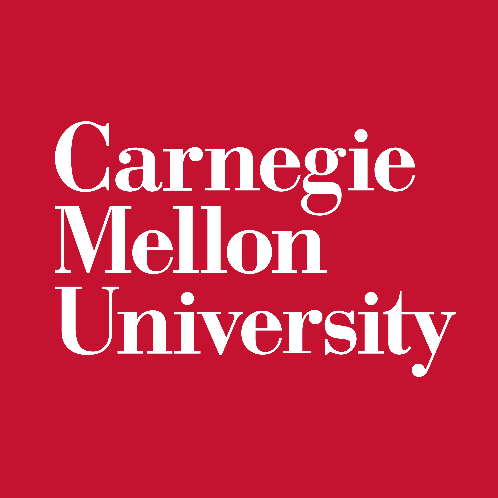

## Biography

Born and raised in Lagos, Nigeria, I completed my B.S. in Economics with a minor in Data Science from Centre College in May 2026. I also competed in the 100m and 200m as a collegiate track and field athlete.

I enjoy working on data science and analytical problems in sports and continue to develop my skills in Python, statistical modeling, and machine learning while keeping up with developments in the field.

In my free time, I enjoy watching and playing sports, going to the gym, and listening to contemporary gospel worship and AfroGospel, among others.

## Education

:::: {.about-entry}
::: {.about-logo}

:::
::: {.about-entry-details}
**Centre College**, Danville, KY

B.S. in Economics & Finance, Data Science minor

*Sep 2022 - May 2026*
:::
::::

:::: {.about-entry}
::: {.about-logo}

:::
::: {.about-entry-details}
**College for Social Innovation**, Boston, MA

Semester in the City (SITC) Fellow

*Aug 2025 - Dec 2025*

Advisor: [Emily Lagas](https://www.linkedin.com/in/emily-lagas-lcsw/)
:::
::::

:::: {.about-entry}
::: {.about-logo}

:::
::: {.about-entry-details}
**African Leadership Academy**, Johannesburg, South Africa

Cambridge A Levels: Physics and Mathematics

*2020 - 2022*
:::
::::

## Experience

:::: {.about-entry}
::: {.about-logo}

:::
::: {.about-entry-details}
**Basketball Analytics Intern**

Los Angeles Sparks

*Feb 2026 - Sep 2026*
:::
::::

:::: {.about-entry}
::: {.about-logo}

:::
::: {.about-entry-details}
**Business Program Development Fellow**

Sustainable Business Network of Massachusetts

*Sep 2025 - Dec 2025*

Supervisor: [Kerry Kokkinogenis](https://www.linkedin.com/in/kerry-kokkinogenis-95a92724/)
:::
::::

:::: {.about-entry}
::: {.about-logo}

:::
::: {.about-entry-details}
**Undergraduate Research Fellow**

Carnegie Mellon University

*Jun 2025 - Jul 2025*

Advisors: [Quang Nguyen](https://www.linkedin.com/in/qntkhvn/) and [Daniel Wicker](https://www.linkedin.com/in/daniel-wicker/) (Charlotte FC)
:::
::::

:::: {.about-entry}
::: {.about-logo}

:::
::: {.about-entry-details}
**Data Analyst: Qualitative & Quantitative Insights**

Beats by Dre, via Extern

*Mar 2025 - Jun 2025*
:::
::::

:::: {.about-entry}
::: {.about-logo}

:::
::: {.about-entry-details}
**Sports Analytics Undergraduate Researcher**

Centre College

*Sep 2024 - Nov 2024*

Advisor: [Jeffrey Heath](https://www.linkedin.com/in/jeffrey-heath-3294598/)
:::
::::

## Conferences Attended

  Apr 2026
  
<strong>ASA Virtual Sports Analytics Conference</strong>Virtual

  Jan 2026
  
<strong>American Soccer Insights Summit</strong>Houston, TX · Oral presentation

  Oct 2025
  
<strong>Carnegie Mellon Sports Analytics Conference</strong>Pittsburgh, PA · Oral presentation

  Mar 2025
  
<strong>SABR Analytics Conference</strong>Phoenix, AZ · Virtual attendance

  Nov 2024
  
<strong>Carnegie Mellon Sports Analytics Conference</strong>Pittsburgh, PA · Poster presentation

## Mentorship & Professional Development

  Mentee
  
<strong>WeStutter@Work Mentorship Program</strong>

  Mentee
  
<strong>2026 NFL Big Data Bowl Mentorship Program</strong>Worked with NFL analytics mentors to analyze player tracking data for the 2026 Big Data Bowl competition.

  Selected Participant
  
<strong>2026 Philadelphia Eagles Virtual Development Series (Business Operations)</strong>A 5-week informational series learning more about the Philadelphia Eagles organization, potential career opportunities, and the career paths of front office executives in addition to networking and interviewing tips.

## Awards

  Feb 2026
  
<strong>CSDS Conference Travel Award</strong>Issued by Texas A&amp;M University &amp; Collaborative for Sport Data Science (CSDS)

  Dec 2025
  
<strong>CFSI Values Award</strong>Issued by the College for Social Innovation (CFSI) · For providing immense value to my internship organization, via capacity building and lasting impact

  Jun 2024
  
<strong>Academic All-District Honor Roll</strong>Issued by the College Sports Communicators (CSC) · For top student-athletes, having a minimum 3.5 GPA and ranked top 50 in region in their individual event(s)

